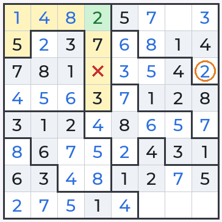

<!-- Written by tools/walkthrough.py jigsaw-8x8: edit the script, not this page. -->
# Jigsaw 8x8, step 31: the 2 in region 1

**Step 31 of 36** · [← Step 30](step-30.md) · [All steps](../jigsaw-8x8.md#the-whole-puzzle-step-by-step) · [Step 32 →](step-32.md)

Region 1 needs a 2. r3c4: row 3 has one (r3c8). Only **r1c4** is left: **r1c4 = 2**.

**Step 31 of 36** · [← Step 30](step-30.md) · [All steps](../jigsaw-8x8.md#the-whole-puzzle-step-by-step) · [Step 32 →](step-32.md)
