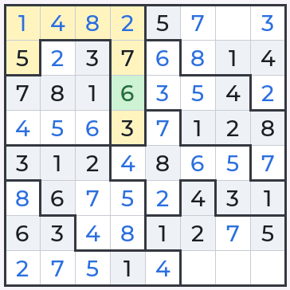

<!-- Written by tools/walkthrough.py jigsaw-8x8: edit the script, not this page. -->
# Jigsaw 8x8, step 32: the 6 in region 1

**Step 32 of 36** · [← Step 31](step-31.md) · [All steps](../jigsaw-8x8.md#the-whole-puzzle-step-by-step) · [Step 33 →](step-33.md)

Region 1 needs a 6, and r3c4 is its last empty cell: **r3c4 = 6**.

**Step 32 of 36** · [← Step 31](step-31.md) · [All steps](../jigsaw-8x8.md#the-whole-puzzle-step-by-step) · [Step 33 →](step-33.md)
