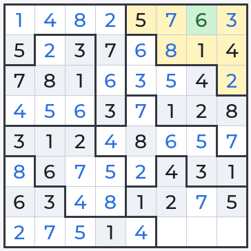

<!-- Written by tools/walkthrough.py jigsaw-8x8: edit the script, not this page. -->
# Jigsaw 8x8, step 33: the 6 in region 2

**Step 33 of 36** · [← Step 32](step-32.md) · [All steps](../jigsaw-8x8.md#the-whole-puzzle-step-by-step) · [Step 34 →](step-34.md)

Region 2 needs a 6, and r1c7 is its last empty cell: **r1c7 = 6**.

**Step 33 of 36** · [← Step 32](step-32.md) · [All steps](../jigsaw-8x8.md#the-whole-puzzle-step-by-step) · [Step 34 →](step-34.md)
