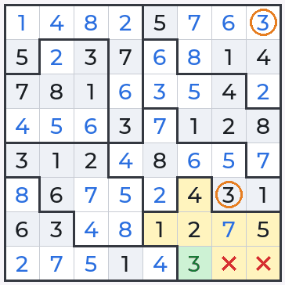

<!-- Written by tools/walkthrough.py jigsaw-8x8: edit the script, not this page. -->
# Jigsaw 8x8, step 34: the 3 in region 8

**Step 34 of 36** · [← Step 33](step-33.md) · [All steps](../jigsaw-8x8.md#the-whole-puzzle-step-by-step) · [Step 35 →](step-35.md)

Region 8 needs a 3. r8c7: column 7 has one (r6c7). r8c8: column 8 has one (r1c8). Only **r8c6** is left: **r8c6 = 3**.

**Step 34 of 36** · [← Step 33](step-33.md) · [All steps](../jigsaw-8x8.md#the-whole-puzzle-step-by-step) · [Step 35 →](step-35.md)
