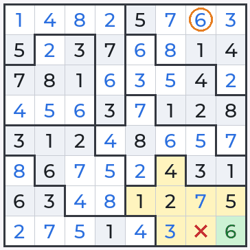

<!-- Written by tools/walkthrough.py jigsaw-8x8: edit the script, not this page. -->
# Jigsaw 8x8, step 35: the 6 in region 8

**Step 35 of 36** · [← Step 34](step-34.md) · [All steps](../jigsaw-8x8.md#the-whole-puzzle-step-by-step) · [Step 36 →](step-36.md)

Region 8 needs a 6. r8c7: column 7 has one (r1c7). Only **r8c8** is left: **r8c8 = 6**.

**Step 35 of 36** · [← Step 34](step-34.md) · [All steps](../jigsaw-8x8.md#the-whole-puzzle-step-by-step) · [Step 36 →](step-36.md)
