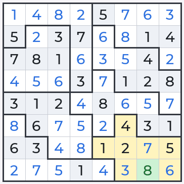

<!-- Written by tools/walkthrough.py jigsaw-8x8: edit the script, not this page. -->
# Jigsaw 8x8, step 36: the 8 in region 8

**Step 36 of 36** · [← Step 35](step-35.md) · [All steps](../jigsaw-8x8.md#the-whole-puzzle-step-by-step) · [All steps](../jigsaw-8x8.md#the-whole-puzzle-step-by-step)

Region 8 needs an 8, and r8c7 is its last empty cell: **r8c7 = 8**.

Solved.

**Step 36 of 36** · [← Step 35](step-35.md) · [All steps](../jigsaw-8x8.md#the-whole-puzzle-step-by-step) · [All steps](../jigsaw-8x8.md#the-whole-puzzle-step-by-step)
