# Jigsaw

[← All variants](README.md) · [Puzzles](../features-puzzles.md) · [How to play](../how-to-play.md)


## The rules

[Classic](classic.md) rules, but the 3×3 boxes are replaced by nine irregular **regions** of nine connected cells, outlined with thick lines. Every row, every column and every region holds 1 to 9, each once. Every puzzle has its own regions.

## On the board

- The regions are drawn with thick borders over a plain grid.
- Hints call them "region 1" to "region 9", numbered by their first cell, left to right, top to bottom.
- **Puzzles → ⋮ → New puzzle → Jigsaw**; it's also Saturday's daily puzzle (Hard). The generator starts from the 3×3 boxes and trades cells across region borders, keeping every region in one piece.

## How to solve it

- Read the shapes first: a region can stretch across several rows and columns, so one placed digit can rule out cells far apart in it.
- **The rule of 45**, without the arithmetic: where a few rows (or columns) together cover whole regions except for a cell or two sticking out, those cells must hold exactly the digits the rows still need. Look for regions that poke one cell into a neighbouring row.
- Naked singles come often in Jigsaw, because a cell sees a different set of cells than its box would give it.

## Worked example

**variant-examples #5**, Jigsaw Easy (see [Classic](classic.md#worked-example) for how to import the examples; cells are written r*row*c*column*).

```
3 2 . . . . . . 9
. . 6 . . 1 2 3 .
. 1 7 . . . . . .
4 3 9 8 6 2 1 . 5
2 . 1 . . . 8 . 3
1 . 5 9 3 8 6 2 4
. . . . . . 7 4 .
. 4 3 1 . . 9 . .
6 . . . . . . 9 1
```

The regions are in the screenshot. Two of them matter here:

- **Region 1** (top left): r1c1, r1c2, r1c3, r2c2, r2c3, r3c2, r3c3, r4c3 and r4c4.
- **Region 6** (the right edge): r1c8, r1c9, r2c9, r3c9, r4c9, r5c9, and r6c7, r6c8, r6c9.

**Step 1: r2c2, in region 1.** Region 1 already has 3, 2, 6, 1, 7, 9 and 8: only 4 and 5 are missing, for its two empty cells r1c3 and r2c2. Column 2 has a 4 (r8c2), so **r2c2 = 5** (and r1c3 will be the 4).

**Step 2: r3c9, in region 6.** Region 6 has 9, 5, 3, 6, 2 and 4, so its three empty cells (r1c8, r2c9, r3c9) share 1, 7 and 8. Row 3 has a 1 (r3c2) and a 7 (r3c3). **r3c9 = 8**.

**Step 3: the 8 in row 1.** Row 1 needs an 8, and has six empty cells:

- r1c3: region 1 has an 8 (r4c4).
- r1c4: column 4 has that 8 too.
- r1c6: column 6 has an 8 (r6c6).
- r1c7: column 7 has an 8 (r5c7).
- r1c8: region 6 now has the 8 from step 2 (r3c9).

Only **r1c5** is left: **r1c5 = 8**. In a Classic grid r1c3 and r1c8 would have been ruled out by their boxes; here it takes the regions.

## The whole puzzle, step by step

<!-- walkthrough -->
<!-- Written by tools/walkthrough.py jigsaw: edit the script, not this part. -->

The whole puzzle, from the start to the last cell: 43 steps, each one a single (one place left for a digit, or one digit left for a cell), taken in the order a box's single comes first, so not quite the order of the worked example above. In each picture, the unit the step looks at is tinted yellow (for a cell with one digit left: its row, column and box), the new digit is on green, the digits that rule cells out have an **orange ring**, and the empty cells they rule out a **red cross**. Givens are on grey, digits from earlier steps in blue.


#### Step 1: the 4 in region 1

Region 1 needs a 4. r2c2: column 2 has one (r8c2). Only **r1c3** is left: **r1c3 = 4**.

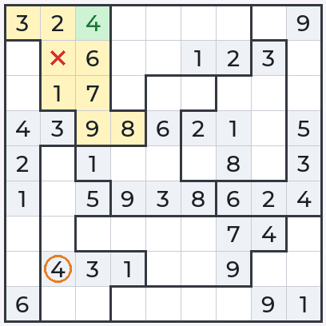

#### Step 2: the 5 in region 1

Region 1 needs a 5, and r2c2 is its last empty cell: **r2c2 = 5**.


#### Step 3: the 3 in region 2

Region 2 needs a 3. r1c4, r1c5, r1c6 and r1c7: row 1 has one (r1c1). r2c4 and r2c5: row 2 has one (r2c8). Only **r3c4** is left: **r3c4 = 3**.

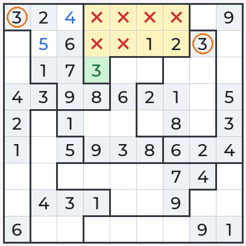

#### Step 4: the 9 in region 2

Region 2 needs a 9. r1c4, r1c5, r1c6 and r1c7: row 1 has one (r1c9). r2c4: column 4 has one (r6c4). Only **r2c5** is left: **r2c5 = 9**.

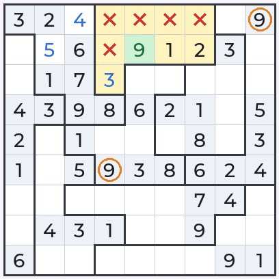

#### Step 5: the 4 in region 2

Region 2 needs a 4. r1c4, r1c5, r1c6 and r1c7: row 1 has one (r1c3). Only **r2c4** is left: **r2c4 = 4**.

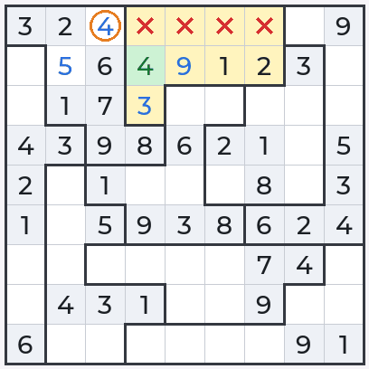

#### Step 6: the 8 in region 2

Region 2 needs an 8. r1c4: column 4 has one (r4c4). r1c6: column 6 has one (r6c6). r1c7: column 7 has one (r5c7). Only **r1c5** is left: **r1c5 = 8**.

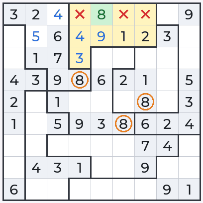

#### Step 7: the 9 in region 3

Region 3 needs a 9. r3c7: column 7 has one (r8c7). r3c8 and r5c8: column 8 has one (r9c8). r4c8: row 4 has one (r4c3). Only **r5c6** is left: **r5c6 = 9**.


#### Step 8: the 4 in region 3

Region 3 needs a 4. r3c8 and r5c8: column 8 has one (r7c8). r4c8: row 4 has one (r4c1). Only **r3c7** is left: **r3c7 = 4**.

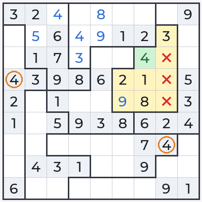

#### Step 9: the 2 in region 5

Region 5 needs a 2. r3c6: column 6 has one (r4c6). r5c4 and r5c5: row 5 has one (r5c1). Only **r3c5** is left: **r3c5 = 2**.

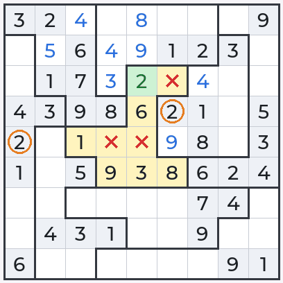

#### Step 10: the 4 in region 5

Region 5 needs a 4. r3c6: row 3 has one (r3c7). r5c4: column 4 has one (r2c4). Only **r5c5** is left: **r5c5 = 4**.

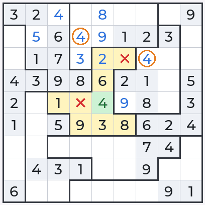

#### Step 11: the 7 in region 5

Region 5 needs a 7. r3c6: row 3 has one (r3c3). Only **r5c4** is left: **r5c4 = 7**.

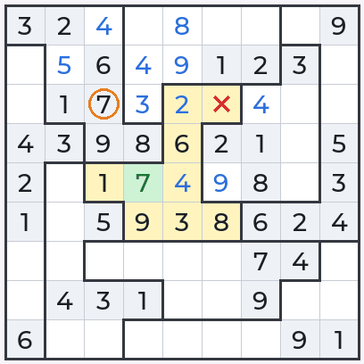

#### Step 12: the 7 in region 2

Region 2 needs a 7. r1c4: column 4 has one (r5c4). r1c7: column 7 has one (r7c7). Only **r1c6** is left: **r1c6 = 7**.


#### Step 13: the 6 in region 2

Region 2 needs a 6. r1c7: column 7 has one (r6c7). Only **r1c4** is left: **r1c4 = 6**.


#### Step 14: the 5 in region 2

Region 2 needs a 5, and r1c7 is its last empty cell: **r1c7 = 5**.


#### Step 15: the 7 in region 3

Region 3 needs a 7. r3c8: row 3 has one (r3c3). r5c8: row 5 has one (r5c4). Only **r4c8** is left: **r4c8 = 7**.

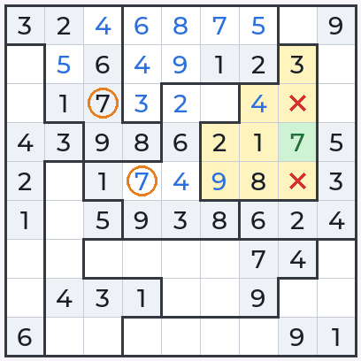

#### Step 16: the 5 in region 5

Region 5 needs a 5, and r3c6 is its last empty cell: **r3c6 = 5**.


#### Step 17: the 5 in region 3

Region 3 needs a 5. r3c8: row 3 has one (r3c6). Only **r5c8** is left: **r5c8 = 5**.


#### Step 18: the 6 in region 3

Region 3 needs a 6, and r3c8 is its last empty cell: **r3c8 = 6**.


#### Step 19: the 1 in region 6

Region 6 needs a 1. r2c9: row 2 has one (r2c6). r3c9: row 3 has one (r3c2). Only **r1c8** is left: **r1c8 = 1**.

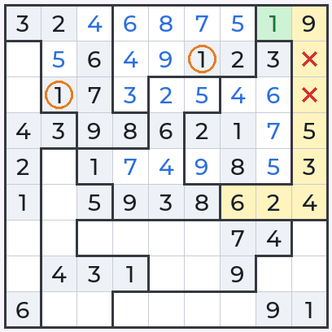

#### Step 20: the 7 in region 6

Region 6 needs a 7. r3c9: row 3 has one (r3c3). Only **r2c9** is left: **r2c9 = 7**.


#### Step 21: the 7 in region 4

Region 4 needs a 7. r2c1: row 2 has one (r2c9). r3c1: row 3 has one (r3c3). r7c1: row 7 has one (r7c7). Only **r8c1** is left: **r8c1 = 7**.


#### Step 22: the 5 in region 4

Region 4 needs a 5. r2c1: row 2 has one (r2c2). r3c1: row 3 has one (r3c6). Only **r7c1** is left: **r7c1 = 5**.

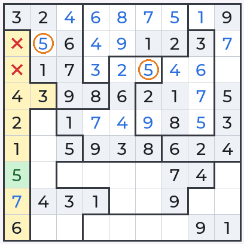

#### Step 23: the 9 in region 4

Region 4 needs a 9. r2c1: row 2 has one (r2c5). Only **r3c1** is left: **r3c1 = 9**.


#### Step 24: the 8 in region 4

Region 4 needs an 8, and r2c1 is its last empty cell: **r2c1 = 8**.

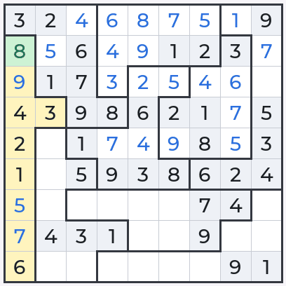

#### Step 25: the 8 in region 6

Region 6 needs an 8, and r3c9 is its last empty cell: **r3c9 = 8**.


#### Step 26: the 2 in region 7

Region 7 needs a 2. r5c2: row 5 has one (r5c1). r6c2: row 6 has one (r6c8). r7c2 and r9c2: column 2 has one (r1c2). Only **r9c3** is left: **r9c3 = 2**.


#### Step 27: the 9 in region 7

Region 7 needs a 9. r5c2: row 5 has one (r5c6). r6c2: row 6 has one (r6c4). r9c2: row 9 has one (r9c8). Only **r7c2** is left: **r7c2 = 9**.

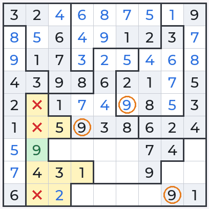

#### Step 28: the 6 in region 7

Region 7 needs a 6. r6c2: row 6 has one (r6c7). r9c2: row 9 has one (r9c1). Only **r5c2** is left: **r5c2 = 6**.


#### Step 29: the 8 in region 7

Region 7 needs an 8. r6c2: row 6 has one (r6c6). Only **r9c2** is left: **r9c2 = 8**.


#### Step 30: the 7 in region 7

Region 7 needs a 7, and r6c2 is its last empty cell: **r6c2 = 7**.

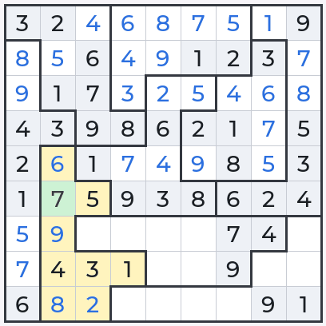

#### Step 31: the 1 in region 8

Region 8 needs a 1. r7c3: column 3 has one (r5c3). r7c4: column 4 has one (r8c4). r7c6: column 6 has one (r2c6). r8c5 and r8c6: row 8 has one (r8c4). Only **r7c5** is left: **r7c5 = 1**.

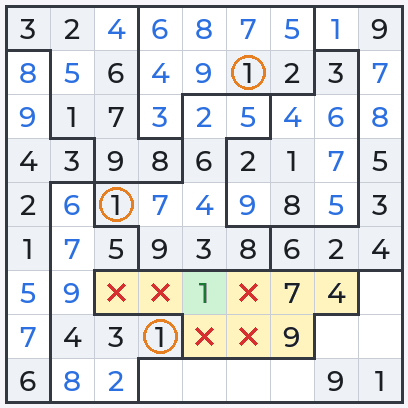

#### Step 32: the 2 in region 8

Region 8 needs a 2. r7c3: column 3 has one (r9c3). r7c6 and r8c6: column 6 has one (r4c6). r8c5: column 5 has one (r3c5). Only **r7c4** is left: **r7c4 = 2**.

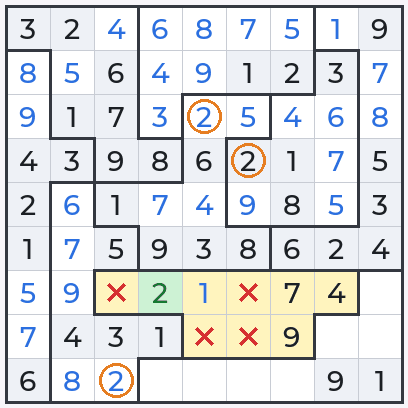

#### Step 33: the 3 in region 8

Region 8 needs a 3. r7c3: column 3 has one (r8c3). r8c5 and r8c6: row 8 has one (r8c3). Only **r7c6** is left: **r7c6 = 3**.


#### Step 34: the 5 in region 8

Region 8 needs a 5. r7c3: row 7 has one (r7c1). r8c6: column 6 has one (r3c6). Only **r8c5** is left: **r8c5 = 5**.


#### Step 35: the 6 in region 8

Region 8 needs a 6. r7c3: column 3 has one (r2c3). Only **r8c6** is left: **r8c6 = 6**.


#### Step 36: the 8 in region 8

Region 8 needs an 8, and r7c3 is its last empty cell: **r7c3 = 8**.

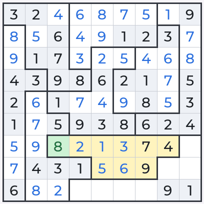

#### Step 37: the 2 in region 9

Region 9 needs a 2. r7c9: row 7 has one (r7c4). r8c8: column 8 has one (r6c8). r9c4, r9c5, r9c6 and r9c7: row 9 has one (r9c3). Only **r8c9** is left: **r8c9 = 2**.

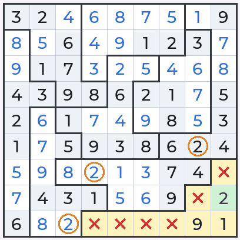

#### Step 38: the 3 in region 9

Region 9 needs a 3. r7c9: row 7 has one (r7c6). r8c8: row 8 has one (r8c3). r9c4: column 4 has one (r3c4). r9c5: column 5 has one (r6c5). r9c6: column 6 has one (r7c6). Only **r9c7** is left: **r9c7 = 3**.


#### Step 39: the 4 in region 9

Region 9 needs a 4. r7c9: row 7 has one (r7c8). r8c8: row 8 has one (r8c2). r9c4: column 4 has one (r2c4). r9c5: column 5 has one (r5c5). Only **r9c6** is left: **r9c6 = 4**.


#### Step 40: the 5 in region 9

Region 9 needs a 5. r7c9: row 7 has one (r7c1). r8c8: row 8 has one (r8c5). r9c5: column 5 has one (r8c5). Only **r9c4** is left: **r9c4 = 5**.


#### Step 41: the 6 in region 9

Region 9 needs a 6. r8c8: row 8 has one (r8c6). r9c5: row 9 has one (r9c1). Only **r7c9** is left: **r7c9 = 6**.


#### Step 42: the 7 in region 9

Region 9 needs a 7. r8c8: row 8 has one (r8c1). Only **r9c5** is left: **r9c5 = 7**.


#### Step 43: the 8 in region 9

Region 9 needs an 8, and r8c8 is its last empty cell: **r8c8 = 8**.

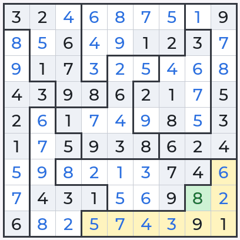

Solved.

<!-- /walkthrough -->
