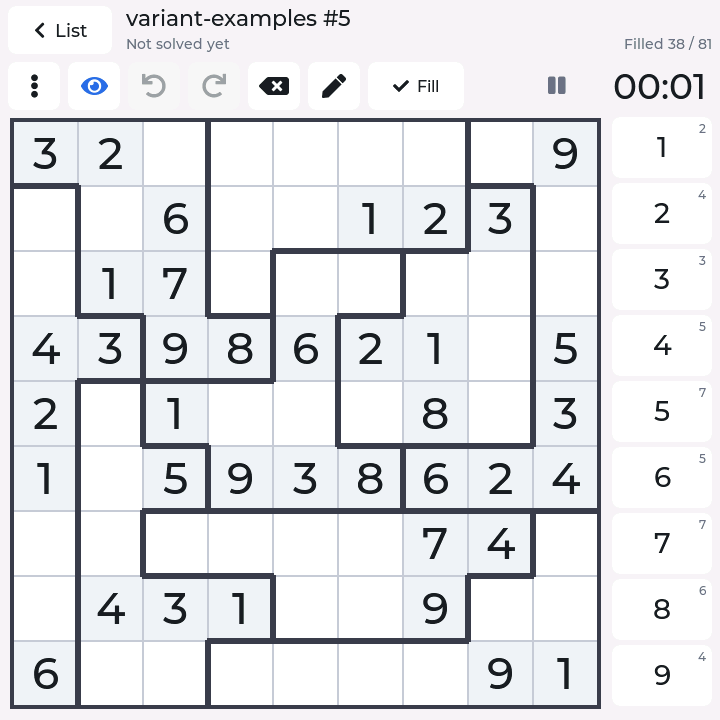
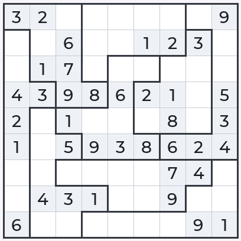

# Jigsaw

[← All variants](README.md) · [Puzzles](../features-puzzles.md) · [How to play](../how-to-play.md)

## The rules

[Classic](classic.md) rules, but the 3×3 boxes are replaced by nine irregular **regions** of nine connected cells, outlined with thick lines. Every row, every column and every region holds 1 to 9, each once. Every puzzle has its own regions.

## On the board

- The regions are drawn with thick borders over a plain grid.
- Hints call them "region 1" to "region 9", numbered by their first cell, left to right, top to bottom.
- **Puzzles → ⋮ → New puzzle → Jigsaw**; it's also Saturday's daily puzzle (Hard). The generator starts from the 3×3 boxes and trades cells across region borders, keeping every region in one piece.

## How to solve it

- Read the shapes first: a region can stretch across several rows and columns, so one placed digit can rule out cells far apart in it.
- **The rule of 45**, without the arithmetic: where a few rows (or columns) together cover whole regions except for a cell or two sticking out, those cells must hold exactly the digits the rows still need. Look for regions that poke one cell into a neighbouring row.
- Naked singles come often in Jigsaw, because a cell sees a different set of cells than its box would give it.

## Worked example

**variant-examples #5**, Jigsaw Easy (see [Classic](classic.md#worked-example-the-whole-puzzle) for how to import the examples; cells are written r*row*c*column*).

The regions are in the screenshot. Two of them matter here:

- **Region 1** (top left): r1c1, r1c2, r1c3, r2c2, r2c3, r3c2, r3c3, r4c3 and r4c4.
- **Region 6** (the right edge): r1c8, r1c9, r2c9, r3c9, r4c9, r5c9, and r6c7, r6c8, r6c9.

**Step 1: r2c2, in region 1.** Region 1 already has 3, 2, 6, 1, 7, 9 and 8: only 4 and 5 are missing, for its two empty cells r1c3 and r2c2. Column 2 has a 4 (r8c2), so **r2c2 = 5** (and r1c3 will be the 4).

**Step 2: r3c9, in region 6.** Region 6 has 9, 5, 3, 6, 2 and 4, so its three empty cells (r1c8, r2c9, r3c9) share 1, 7 and 8. Row 3 has a 1 (r3c2) and a 7 (r3c3). **r3c9 = 8**.

**Step 3: the 8 in row 1.** Row 1 needs an 8, and has six empty cells:

- r1c3: region 1 has an 8 (r4c4).
- r1c4: column 4 has that 8 too.
- r1c6: column 6 has an 8 (r6c6).
- r1c7: column 7 has an 8 (r5c7).
- r1c8: region 6 now has the 8 from step 2 (r3c9).

Only **r1c5** is left: **r1c5 = 8**. In a Classic grid r1c3 and r1c8 would have been ruled out by their boxes; here it takes the regions.

## The whole puzzle, step by step

<!-- walkthrough -->
<!-- Written by tools/walkthrough.py jigsaw: edit the script, not this part. -->

The whole puzzle, from the start to the last cell: 43 steps, each one a single (one place left for a digit, or one digit left for a cell), taken in the order a box's single comes first, so not quite the order of the worked example above. Each step has a page of its own, with **Previous** and **Next**: pick one from the list below. In each picture, the unit the step looks at is tinted yellow (for a cell with one digit left: its row, column and box), the new digit is on green, the digits that rule cells out have an **orange ring**, and the empty cells they rule out a **red cross**. Givens are on grey, digits from earlier steps in blue.

1. [the 4 in region 1](jigsaw/step-01.md)
2. [the 5 in region 1](jigsaw/step-02.md)
3. [the 3 in region 2](jigsaw/step-03.md)
4. [the 9 in region 2](jigsaw/step-04.md)
5. [the 4 in region 2](jigsaw/step-05.md)
6. [the 8 in region 2](jigsaw/step-06.md)
7. [the 9 in region 3](jigsaw/step-07.md)
8. [the 4 in region 3](jigsaw/step-08.md)
9. [the 2 in region 5](jigsaw/step-09.md)
10. [the 4 in region 5](jigsaw/step-10.md)
11. [the 7 in region 5](jigsaw/step-11.md)
12. [the 7 in region 2](jigsaw/step-12.md)
13. [the 6 in region 2](jigsaw/step-13.md)
14. [the 5 in region 2](jigsaw/step-14.md)
15. [the 7 in region 3](jigsaw/step-15.md)
16. [the 5 in region 5](jigsaw/step-16.md)
17. [the 5 in region 3](jigsaw/step-17.md)
18. [the 6 in region 3](jigsaw/step-18.md)
19. [the 1 in region 6](jigsaw/step-19.md)
20. [the 7 in region 6](jigsaw/step-20.md)
21. [the 7 in region 4](jigsaw/step-21.md)
22. [the 5 in region 4](jigsaw/step-22.md)
23. [the 9 in region 4](jigsaw/step-23.md)
24. [the 8 in region 4](jigsaw/step-24.md)
25. [the 8 in region 6](jigsaw/step-25.md)
26. [the 2 in region 7](jigsaw/step-26.md)
27. [the 9 in region 7](jigsaw/step-27.md)
28. [the 6 in region 7](jigsaw/step-28.md)
29. [the 8 in region 7](jigsaw/step-29.md)
30. [the 7 in region 7](jigsaw/step-30.md)
31. [the 1 in region 8](jigsaw/step-31.md)
32. [the 2 in region 8](jigsaw/step-32.md)
33. [the 3 in region 8](jigsaw/step-33.md)
34. [the 5 in region 8](jigsaw/step-34.md)
35. [the 6 in region 8](jigsaw/step-35.md)
36. [the 8 in region 8](jigsaw/step-36.md)
37. [the 2 in region 9](jigsaw/step-37.md)
38. [the 3 in region 9](jigsaw/step-38.md)
39. [the 4 in region 9](jigsaw/step-39.md)
40. [the 5 in region 9](jigsaw/step-40.md)
41. [the 6 in region 9](jigsaw/step-41.md)
42. [the 7 in region 9](jigsaw/step-42.md)
43. [the 8 in region 9](jigsaw/step-43.md)

Solved.

<!-- /walkthrough -->
