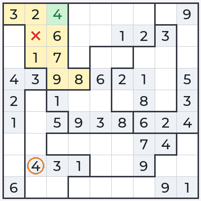

<!-- Written by tools/walkthrough.py jigsaw: edit the script, not this page. -->
# Jigsaw, step 1: the 4 in region 1

**Step 1 of 43** · [← The start](../jigsaw.md#the-whole-puzzle-step-by-step) · [All steps](../jigsaw.md#the-whole-puzzle-step-by-step) · [Step 2 →](step-02.md)

Region 1 needs a 4. r2c2: column 2 has one (r8c2). Only **r1c3** is left: **r1c3 = 4**.

**Step 1 of 43** · [← The start](../jigsaw.md#the-whole-puzzle-step-by-step) · [All steps](../jigsaw.md#the-whole-puzzle-step-by-step) · [Step 2 →](step-02.md)
