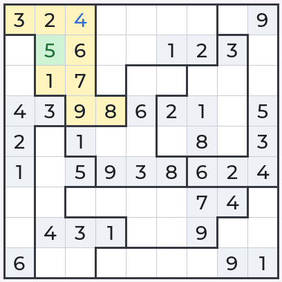

<!-- Written by tools/walkthrough.py jigsaw: edit the script, not this page. -->
# Jigsaw, step 2: the 5 in region 1

**Step 2 of 43** · [← Step 1](step-01.md) · [All steps](../jigsaw.md#the-whole-puzzle-step-by-step) · [Step 3 →](step-03.md)

Region 1 needs a 5, and r2c2 is its last empty cell: **r2c2 = 5**.

**Step 2 of 43** · [← Step 1](step-01.md) · [All steps](../jigsaw.md#the-whole-puzzle-step-by-step) · [Step 3 →](step-03.md)
