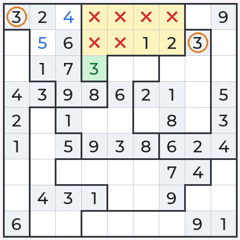

<!-- Written by tools/walkthrough.py jigsaw: edit the script, not this page. -->
# Jigsaw, step 3: the 3 in region 2

**Step 3 of 43** · [← Step 2](step-02.md) · [All steps](../jigsaw.md#the-whole-puzzle-step-by-step) · [Step 4 →](step-04.md)

Region 2 needs a 3. r1c4, r1c5, r1c6 and r1c7: row 1 has one (r1c1). r2c4 and r2c5: row 2 has one (r2c8). Only **r3c4** is left: **r3c4 = 3**.

**Step 3 of 43** · [← Step 2](step-02.md) · [All steps](../jigsaw.md#the-whole-puzzle-step-by-step) · [Step 4 →](step-04.md)
