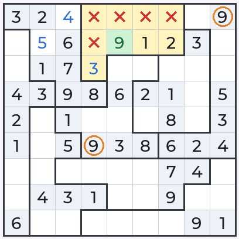

<!-- Written by tools/walkthrough.py jigsaw: edit the script, not this page. -->
# Jigsaw, step 4: the 9 in region 2

**Step 4 of 43** · [← Step 3](step-03.md) · [All steps](../jigsaw.md#the-whole-puzzle-step-by-step) · [Step 5 →](step-05.md)

Region 2 needs a 9. r1c4, r1c5, r1c6 and r1c7: row 1 has one (r1c9). r2c4: column 4 has one (r6c4). Only **r2c5** is left: **r2c5 = 9**.

**Step 4 of 43** · [← Step 3](step-03.md) · [All steps](../jigsaw.md#the-whole-puzzle-step-by-step) · [Step 5 →](step-05.md)
