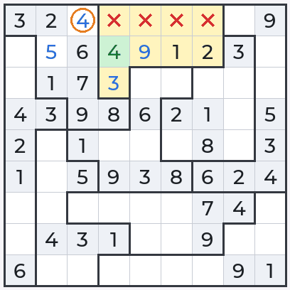

<!-- Written by tools/walkthrough.py jigsaw: edit the script, not this page. -->
# Jigsaw, step 5: the 4 in region 2

**Step 5 of 43** · [← Step 4](step-04.md) · [All steps](../jigsaw.md#the-whole-puzzle-step-by-step) · [Step 6 →](step-06.md)

Region 2 needs a 4. r1c4, r1c5, r1c6 and r1c7: row 1 has one (r1c3). Only **r2c4** is left: **r2c4 = 4**.

**Step 5 of 43** · [← Step 4](step-04.md) · [All steps](../jigsaw.md#the-whole-puzzle-step-by-step) · [Step 6 →](step-06.md)
