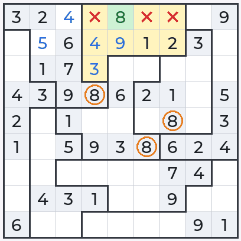

<!-- Written by tools/walkthrough.py jigsaw: edit the script, not this page. -->
# Jigsaw, step 6: the 8 in region 2

**Step 6 of 43** · [← Step 5](step-05.md) · [All steps](../jigsaw.md#the-whole-puzzle-step-by-step) · [Step 7 →](step-07.md)

Region 2 needs an 8. r1c4: column 4 has one (r4c4). r1c6: column 6 has one (r6c6). r1c7: column 7 has one (r5c7). Only **r1c5** is left: **r1c5 = 8**.

**Step 6 of 43** · [← Step 5](step-05.md) · [All steps](../jigsaw.md#the-whole-puzzle-step-by-step) · [Step 7 →](step-07.md)
