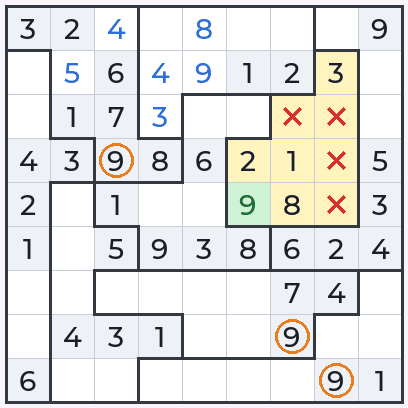

<!-- Written by tools/walkthrough.py jigsaw: edit the script, not this page. -->
# Jigsaw, step 7: the 9 in region 3

**Step 7 of 43** · [← Step 6](step-06.md) · [All steps](../jigsaw.md#the-whole-puzzle-step-by-step) · [Step 8 →](step-08.md)

Region 3 needs a 9. r3c7: column 7 has one (r8c7). r3c8 and r5c8: column 8 has one (r9c8). r4c8: row 4 has one (r4c3). Only **r5c6** is left: **r5c6 = 9**.

**Step 7 of 43** · [← Step 6](step-06.md) · [All steps](../jigsaw.md#the-whole-puzzle-step-by-step) · [Step 8 →](step-08.md)
