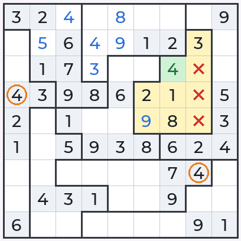

<!-- Written by tools/walkthrough.py jigsaw: edit the script, not this page. -->
# Jigsaw, step 8: the 4 in region 3

**Step 8 of 43** · [← Step 7](step-07.md) · [All steps](../jigsaw.md#the-whole-puzzle-step-by-step) · [Step 9 →](step-09.md)

Region 3 needs a 4. r3c8 and r5c8: column 8 has one (r7c8). r4c8: row 4 has one (r4c1). Only **r3c7** is left: **r3c7 = 4**.

**Step 8 of 43** · [← Step 7](step-07.md) · [All steps](../jigsaw.md#the-whole-puzzle-step-by-step) · [Step 9 →](step-09.md)
