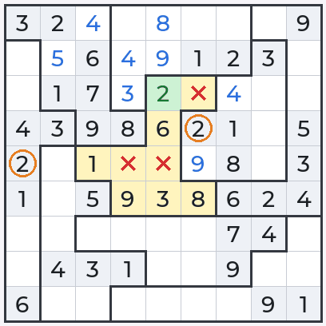

<!-- Written by tools/walkthrough.py jigsaw: edit the script, not this page. -->
# Jigsaw, step 9: the 2 in region 5

**Step 9 of 43** · [← Step 8](step-08.md) · [All steps](../jigsaw.md#the-whole-puzzle-step-by-step) · [Step 10 →](step-10.md)

Region 5 needs a 2. r3c6: column 6 has one (r4c6). r5c4 and r5c5: row 5 has one (r5c1). Only **r3c5** is left: **r3c5 = 2**.

**Step 9 of 43** · [← Step 8](step-08.md) · [All steps](../jigsaw.md#the-whole-puzzle-step-by-step) · [Step 10 →](step-10.md)
