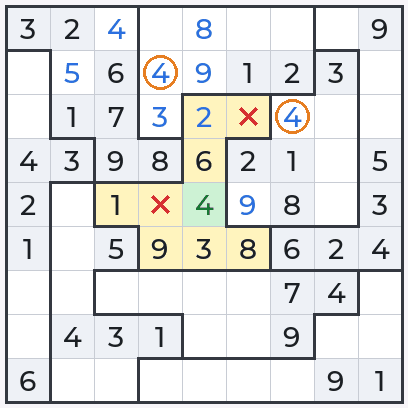

<!-- Written by tools/walkthrough.py jigsaw: edit the script, not this page. -->
# Jigsaw, step 10: the 4 in region 5

**Step 10 of 43** · [← Step 9](step-09.md) · [All steps](../jigsaw.md#the-whole-puzzle-step-by-step) · [Step 11 →](step-11.md)

Region 5 needs a 4. r3c6: row 3 has one (r3c7). r5c4: column 4 has one (r2c4). Only **r5c5** is left: **r5c5 = 4**.

**Step 10 of 43** · [← Step 9](step-09.md) · [All steps](../jigsaw.md#the-whole-puzzle-step-by-step) · [Step 11 →](step-11.md)
