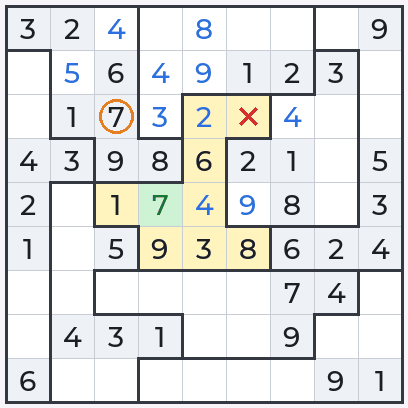

<!-- Written by tools/walkthrough.py jigsaw: edit the script, not this page. -->
# Jigsaw, step 11: the 7 in region 5

**Step 11 of 43** · [← Step 10](step-10.md) · [All steps](../jigsaw.md#the-whole-puzzle-step-by-step) · [Step 12 →](step-12.md)

Region 5 needs a 7. r3c6: row 3 has one (r3c3). Only **r5c4** is left: **r5c4 = 7**.

**Step 11 of 43** · [← Step 10](step-10.md) · [All steps](../jigsaw.md#the-whole-puzzle-step-by-step) · [Step 12 →](step-12.md)
