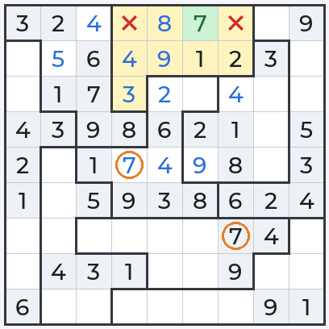

<!-- Written by tools/walkthrough.py jigsaw: edit the script, not this page. -->
# Jigsaw, step 12: the 7 in region 2

**Step 12 of 43** · [← Step 11](step-11.md) · [All steps](../jigsaw.md#the-whole-puzzle-step-by-step) · [Step 13 →](step-13.md)

Region 2 needs a 7. r1c4: column 4 has one (r5c4). r1c7: column 7 has one (r7c7). Only **r1c6** is left: **r1c6 = 7**.

**Step 12 of 43** · [← Step 11](step-11.md) · [All steps](../jigsaw.md#the-whole-puzzle-step-by-step) · [Step 13 →](step-13.md)
