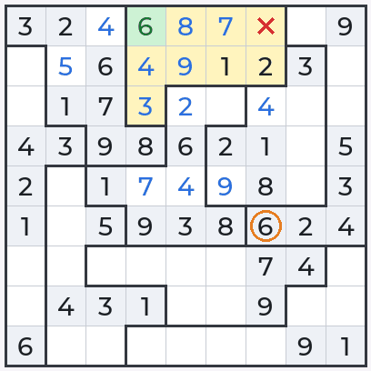

<!-- Written by tools/walkthrough.py jigsaw: edit the script, not this page. -->
# Jigsaw, step 13: the 6 in region 2

**Step 13 of 43** · [← Step 12](step-12.md) · [All steps](../jigsaw.md#the-whole-puzzle-step-by-step) · [Step 14 →](step-14.md)

Region 2 needs a 6. r1c7: column 7 has one (r6c7). Only **r1c4** is left: **r1c4 = 6**.

**Step 13 of 43** · [← Step 12](step-12.md) · [All steps](../jigsaw.md#the-whole-puzzle-step-by-step) · [Step 14 →](step-14.md)
