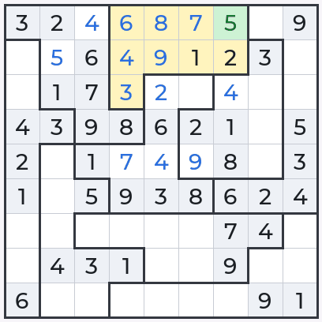

<!-- Written by tools/walkthrough.py jigsaw: edit the script, not this page. -->
# Jigsaw, step 14: the 5 in region 2

**Step 14 of 43** · [← Step 13](step-13.md) · [All steps](../jigsaw.md#the-whole-puzzle-step-by-step) · [Step 15 →](step-15.md)

Region 2 needs a 5, and r1c7 is its last empty cell: **r1c7 = 5**.

**Step 14 of 43** · [← Step 13](step-13.md) · [All steps](../jigsaw.md#the-whole-puzzle-step-by-step) · [Step 15 →](step-15.md)
