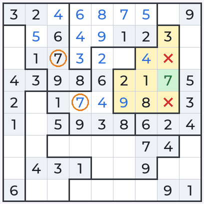

<!-- Written by tools/walkthrough.py jigsaw: edit the script, not this page. -->
# Jigsaw, step 15: the 7 in region 3

**Step 15 of 43** · [← Step 14](step-14.md) · [All steps](../jigsaw.md#the-whole-puzzle-step-by-step) · [Step 16 →](step-16.md)

Region 3 needs a 7. r3c8: row 3 has one (r3c3). r5c8: row 5 has one (r5c4). Only **r4c8** is left: **r4c8 = 7**.

**Step 15 of 43** · [← Step 14](step-14.md) · [All steps](../jigsaw.md#the-whole-puzzle-step-by-step) · [Step 16 →](step-16.md)
