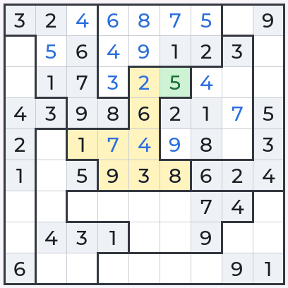

<!-- Written by tools/walkthrough.py jigsaw: edit the script, not this page. -->
# Jigsaw, step 16: the 5 in region 5

**Step 16 of 43** · [← Step 15](step-15.md) · [All steps](../jigsaw.md#the-whole-puzzle-step-by-step) · [Step 17 →](step-17.md)

Region 5 needs a 5, and r3c6 is its last empty cell: **r3c6 = 5**.

**Step 16 of 43** · [← Step 15](step-15.md) · [All steps](../jigsaw.md#the-whole-puzzle-step-by-step) · [Step 17 →](step-17.md)
