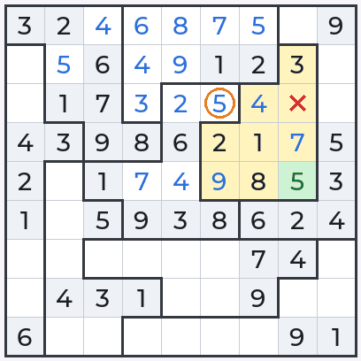

<!-- Written by tools/walkthrough.py jigsaw: edit the script, not this page. -->
# Jigsaw, step 17: the 5 in region 3

**Step 17 of 43** · [← Step 16](step-16.md) · [All steps](../jigsaw.md#the-whole-puzzle-step-by-step) · [Step 18 →](step-18.md)

Region 3 needs a 5. r3c8: row 3 has one (r3c6). Only **r5c8** is left: **r5c8 = 5**.

**Step 17 of 43** · [← Step 16](step-16.md) · [All steps](../jigsaw.md#the-whole-puzzle-step-by-step) · [Step 18 →](step-18.md)
