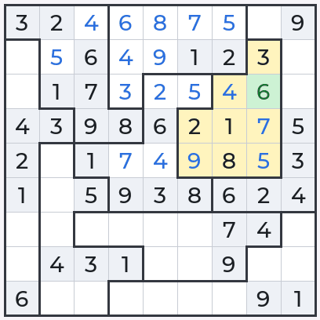

<!-- Written by tools/walkthrough.py jigsaw: edit the script, not this page. -->
# Jigsaw, step 18: the 6 in region 3

**Step 18 of 43** · [← Step 17](step-17.md) · [All steps](../jigsaw.md#the-whole-puzzle-step-by-step) · [Step 19 →](step-19.md)

Region 3 needs a 6, and r3c8 is its last empty cell: **r3c8 = 6**.

**Step 18 of 43** · [← Step 17](step-17.md) · [All steps](../jigsaw.md#the-whole-puzzle-step-by-step) · [Step 19 →](step-19.md)
