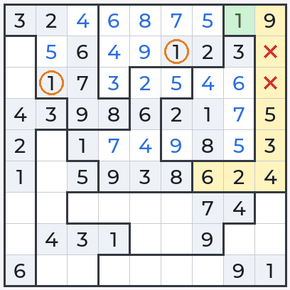

<!-- Written by tools/walkthrough.py jigsaw: edit the script, not this page. -->
# Jigsaw, step 19: the 1 in region 6

**Step 19 of 43** · [← Step 18](step-18.md) · [All steps](../jigsaw.md#the-whole-puzzle-step-by-step) · [Step 20 →](step-20.md)

Region 6 needs a 1. r2c9: row 2 has one (r2c6). r3c9: row 3 has one (r3c2). Only **r1c8** is left: **r1c8 = 1**.

**Step 19 of 43** · [← Step 18](step-18.md) · [All steps](../jigsaw.md#the-whole-puzzle-step-by-step) · [Step 20 →](step-20.md)
