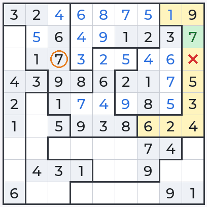

<!-- Written by tools/walkthrough.py jigsaw: edit the script, not this page. -->
# Jigsaw, step 20: the 7 in region 6

**Step 20 of 43** · [← Step 19](step-19.md) · [All steps](../jigsaw.md#the-whole-puzzle-step-by-step) · [Step 21 →](step-21.md)

Region 6 needs a 7. r3c9: row 3 has one (r3c3). Only **r2c9** is left: **r2c9 = 7**.

**Step 20 of 43** · [← Step 19](step-19.md) · [All steps](../jigsaw.md#the-whole-puzzle-step-by-step) · [Step 21 →](step-21.md)
