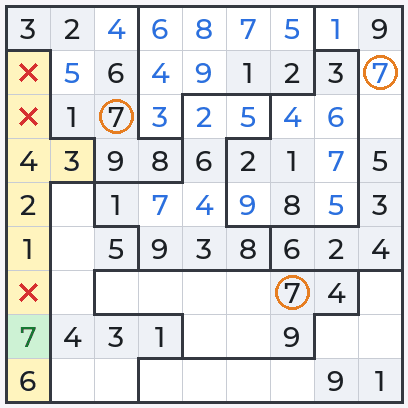

<!-- Written by tools/walkthrough.py jigsaw: edit the script, not this page. -->
# Jigsaw, step 21: the 7 in region 4

**Step 21 of 43** · [← Step 20](step-20.md) · [All steps](../jigsaw.md#the-whole-puzzle-step-by-step) · [Step 22 →](step-22.md)

Region 4 needs a 7. r2c1: row 2 has one (r2c9). r3c1: row 3 has one (r3c3). r7c1: row 7 has one (r7c7). Only **r8c1** is left: **r8c1 = 7**.

**Step 21 of 43** · [← Step 20](step-20.md) · [All steps](../jigsaw.md#the-whole-puzzle-step-by-step) · [Step 22 →](step-22.md)
