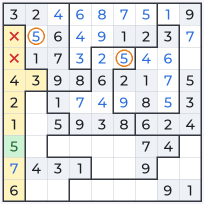

<!-- Written by tools/walkthrough.py jigsaw: edit the script, not this page. -->
# Jigsaw, step 22: the 5 in region 4

**Step 22 of 43** · [← Step 21](step-21.md) · [All steps](../jigsaw.md#the-whole-puzzle-step-by-step) · [Step 23 →](step-23.md)

Region 4 needs a 5. r2c1: row 2 has one (r2c2). r3c1: row 3 has one (r3c6). Only **r7c1** is left: **r7c1 = 5**.

**Step 22 of 43** · [← Step 21](step-21.md) · [All steps](../jigsaw.md#the-whole-puzzle-step-by-step) · [Step 23 →](step-23.md)
