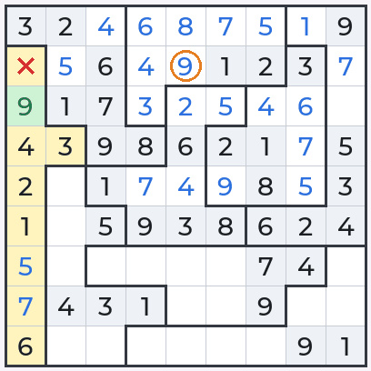

<!-- Written by tools/walkthrough.py jigsaw: edit the script, not this page. -->
# Jigsaw, step 23: the 9 in region 4

**Step 23 of 43** · [← Step 22](step-22.md) · [All steps](../jigsaw.md#the-whole-puzzle-step-by-step) · [Step 24 →](step-24.md)

Region 4 needs a 9. r2c1: row 2 has one (r2c5). Only **r3c1** is left: **r3c1 = 9**.

**Step 23 of 43** · [← Step 22](step-22.md) · [All steps](../jigsaw.md#the-whole-puzzle-step-by-step) · [Step 24 →](step-24.md)
