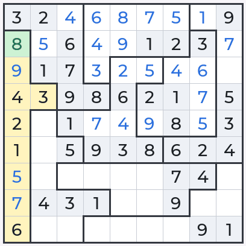

<!-- Written by tools/walkthrough.py jigsaw: edit the script, not this page. -->
# Jigsaw, step 24: the 8 in region 4

**Step 24 of 43** · [← Step 23](step-23.md) · [All steps](../jigsaw.md#the-whole-puzzle-step-by-step) · [Step 25 →](step-25.md)

Region 4 needs an 8, and r2c1 is its last empty cell: **r2c1 = 8**.

**Step 24 of 43** · [← Step 23](step-23.md) · [All steps](../jigsaw.md#the-whole-puzzle-step-by-step) · [Step 25 →](step-25.md)
