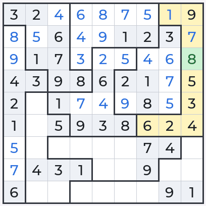

<!-- Written by tools/walkthrough.py jigsaw: edit the script, not this page. -->
# Jigsaw, step 25: the 8 in region 6

**Step 25 of 43** · [← Step 24](step-24.md) · [All steps](../jigsaw.md#the-whole-puzzle-step-by-step) · [Step 26 →](step-26.md)

Region 6 needs an 8, and r3c9 is its last empty cell: **r3c9 = 8**.

**Step 25 of 43** · [← Step 24](step-24.md) · [All steps](../jigsaw.md#the-whole-puzzle-step-by-step) · [Step 26 →](step-26.md)
