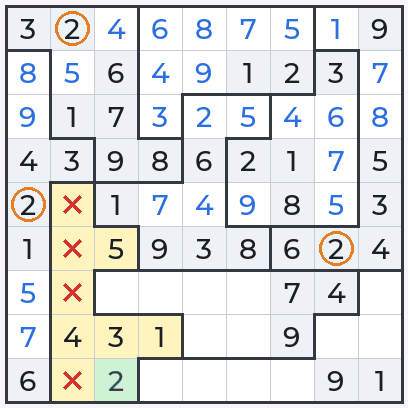

<!-- Written by tools/walkthrough.py jigsaw: edit the script, not this page. -->
# Jigsaw, step 26: the 2 in region 7

**Step 26 of 43** · [← Step 25](step-25.md) · [All steps](../jigsaw.md#the-whole-puzzle-step-by-step) · [Step 27 →](step-27.md)

Region 7 needs a 2. r5c2: row 5 has one (r5c1). r6c2: row 6 has one (r6c8). r7c2 and r9c2: column 2 has one (r1c2). Only **r9c3** is left: **r9c3 = 2**.

**Step 26 of 43** · [← Step 25](step-25.md) · [All steps](../jigsaw.md#the-whole-puzzle-step-by-step) · [Step 27 →](step-27.md)
