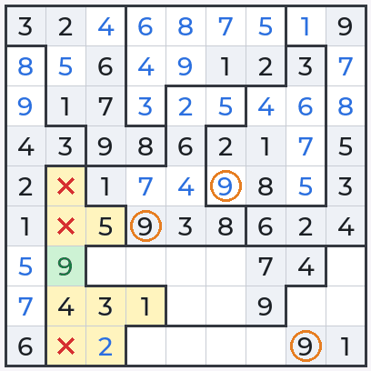

<!-- Written by tools/walkthrough.py jigsaw: edit the script, not this page. -->
# Jigsaw, step 27: the 9 in region 7

**Step 27 of 43** · [← Step 26](step-26.md) · [All steps](../jigsaw.md#the-whole-puzzle-step-by-step) · [Step 28 →](step-28.md)

Region 7 needs a 9. r5c2: row 5 has one (r5c6). r6c2: row 6 has one (r6c4). r9c2: row 9 has one (r9c8). Only **r7c2** is left: **r7c2 = 9**.

**Step 27 of 43** · [← Step 26](step-26.md) · [All steps](../jigsaw.md#the-whole-puzzle-step-by-step) · [Step 28 →](step-28.md)
