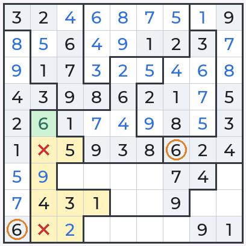

<!-- Written by tools/walkthrough.py jigsaw: edit the script, not this page. -->
# Jigsaw, step 28: the 6 in region 7

**Step 28 of 43** · [← Step 27](step-27.md) · [All steps](../jigsaw.md#the-whole-puzzle-step-by-step) · [Step 29 →](step-29.md)

Region 7 needs a 6. r6c2: row 6 has one (r6c7). r9c2: row 9 has one (r9c1). Only **r5c2** is left: **r5c2 = 6**.

**Step 28 of 43** · [← Step 27](step-27.md) · [All steps](../jigsaw.md#the-whole-puzzle-step-by-step) · [Step 29 →](step-29.md)
