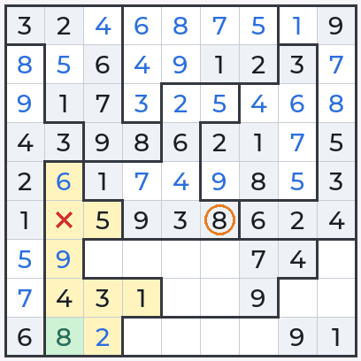

<!-- Written by tools/walkthrough.py jigsaw: edit the script, not this page. -->
# Jigsaw, step 29: the 8 in region 7

**Step 29 of 43** · [← Step 28](step-28.md) · [All steps](../jigsaw.md#the-whole-puzzle-step-by-step) · [Step 30 →](step-30.md)

Region 7 needs an 8. r6c2: row 6 has one (r6c6). Only **r9c2** is left: **r9c2 = 8**.

**Step 29 of 43** · [← Step 28](step-28.md) · [All steps](../jigsaw.md#the-whole-puzzle-step-by-step) · [Step 30 →](step-30.md)
