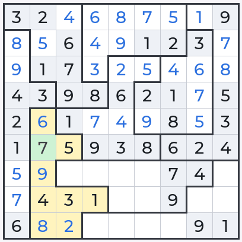

<!-- Written by tools/walkthrough.py jigsaw: edit the script, not this page. -->
# Jigsaw, step 30: the 7 in region 7

**Step 30 of 43** · [← Step 29](step-29.md) · [All steps](../jigsaw.md#the-whole-puzzle-step-by-step) · [Step 31 →](step-31.md)

Region 7 needs a 7, and r6c2 is its last empty cell: **r6c2 = 7**.

**Step 30 of 43** · [← Step 29](step-29.md) · [All steps](../jigsaw.md#the-whole-puzzle-step-by-step) · [Step 31 →](step-31.md)
