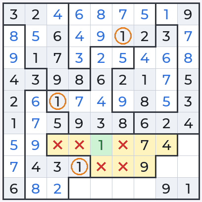

<!-- Written by tools/walkthrough.py jigsaw: edit the script, not this page. -->
# Jigsaw, step 31: the 1 in region 8

**Step 31 of 43** · [← Step 30](step-30.md) · [All steps](../jigsaw.md#the-whole-puzzle-step-by-step) · [Step 32 →](step-32.md)

Region 8 needs a 1. r7c3: column 3 has one (r5c3). r7c4: column 4 has one (r8c4). r7c6: column 6 has one (r2c6). r8c5 and r8c6: row 8 has one (r8c4). Only **r7c5** is left: **r7c5 = 1**.

**Step 31 of 43** · [← Step 30](step-30.md) · [All steps](../jigsaw.md#the-whole-puzzle-step-by-step) · [Step 32 →](step-32.md)
