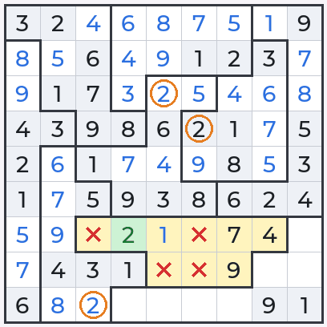

<!-- Written by tools/walkthrough.py jigsaw: edit the script, not this page. -->
# Jigsaw, step 32: the 2 in region 8

**Step 32 of 43** · [← Step 31](step-31.md) · [All steps](../jigsaw.md#the-whole-puzzle-step-by-step) · [Step 33 →](step-33.md)

Region 8 needs a 2. r7c3: column 3 has one (r9c3). r7c6 and r8c6: column 6 has one (r4c6). r8c5: column 5 has one (r3c5). Only **r7c4** is left: **r7c4 = 2**.

**Step 32 of 43** · [← Step 31](step-31.md) · [All steps](../jigsaw.md#the-whole-puzzle-step-by-step) · [Step 33 →](step-33.md)
