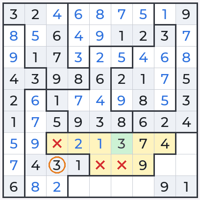

<!-- Written by tools/walkthrough.py jigsaw: edit the script, not this page. -->
# Jigsaw, step 33: the 3 in region 8

**Step 33 of 43** · [← Step 32](step-32.md) · [All steps](../jigsaw.md#the-whole-puzzle-step-by-step) · [Step 34 →](step-34.md)

Region 8 needs a 3. r7c3: column 3 has one (r8c3). r8c5 and r8c6: row 8 has one (r8c3). Only **r7c6** is left: **r7c6 = 3**.

**Step 33 of 43** · [← Step 32](step-32.md) · [All steps](../jigsaw.md#the-whole-puzzle-step-by-step) · [Step 34 →](step-34.md)
