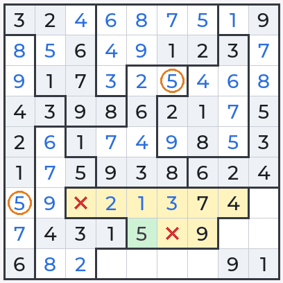

<!-- Written by tools/walkthrough.py jigsaw: edit the script, not this page. -->
# Jigsaw, step 34: the 5 in region 8

**Step 34 of 43** · [← Step 33](step-33.md) · [All steps](../jigsaw.md#the-whole-puzzle-step-by-step) · [Step 35 →](step-35.md)

Region 8 needs a 5. r7c3: row 7 has one (r7c1). r8c6: column 6 has one (r3c6). Only **r8c5** is left: **r8c5 = 5**.

**Step 34 of 43** · [← Step 33](step-33.md) · [All steps](../jigsaw.md#the-whole-puzzle-step-by-step) · [Step 35 →](step-35.md)
