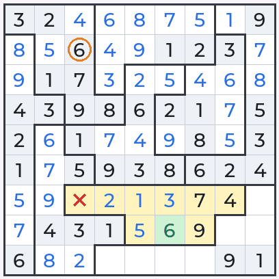

<!-- Written by tools/walkthrough.py jigsaw: edit the script, not this page. -->
# Jigsaw, step 35: the 6 in region 8

**Step 35 of 43** · [← Step 34](step-34.md) · [All steps](../jigsaw.md#the-whole-puzzle-step-by-step) · [Step 36 →](step-36.md)

Region 8 needs a 6. r7c3: column 3 has one (r2c3). Only **r8c6** is left: **r8c6 = 6**.

**Step 35 of 43** · [← Step 34](step-34.md) · [All steps](../jigsaw.md#the-whole-puzzle-step-by-step) · [Step 36 →](step-36.md)
