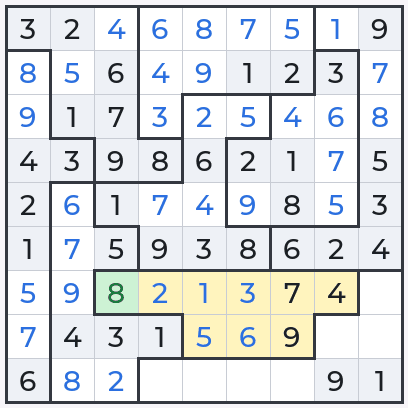

<!-- Written by tools/walkthrough.py jigsaw: edit the script, not this page. -->
# Jigsaw, step 36: the 8 in region 8

**Step 36 of 43** · [← Step 35](step-35.md) · [All steps](../jigsaw.md#the-whole-puzzle-step-by-step) · [Step 37 →](step-37.md)

Region 8 needs an 8, and r7c3 is its last empty cell: **r7c3 = 8**.

**Step 36 of 43** · [← Step 35](step-35.md) · [All steps](../jigsaw.md#the-whole-puzzle-step-by-step) · [Step 37 →](step-37.md)
