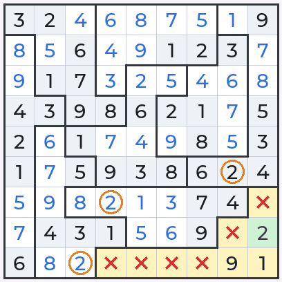

<!-- Written by tools/walkthrough.py jigsaw: edit the script, not this page. -->
# Jigsaw, step 37: the 2 in region 9

**Step 37 of 43** · [← Step 36](step-36.md) · [All steps](../jigsaw.md#the-whole-puzzle-step-by-step) · [Step 38 →](step-38.md)

Region 9 needs a 2. r7c9: row 7 has one (r7c4). r8c8: column 8 has one (r6c8). r9c4, r9c5, r9c6 and r9c7: row 9 has one (r9c3). Only **r8c9** is left: **r8c9 = 2**.

**Step 37 of 43** · [← Step 36](step-36.md) · [All steps](../jigsaw.md#the-whole-puzzle-step-by-step) · [Step 38 →](step-38.md)
