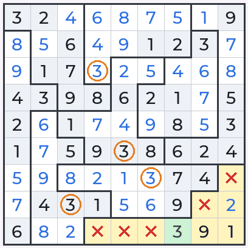

<!-- Written by tools/walkthrough.py jigsaw: edit the script, not this page. -->
# Jigsaw, step 38: the 3 in region 9

**Step 38 of 43** · [← Step 37](step-37.md) · [All steps](../jigsaw.md#the-whole-puzzle-step-by-step) · [Step 39 →](step-39.md)

Region 9 needs a 3. r7c9: row 7 has one (r7c6). r8c8: row 8 has one (r8c3). r9c4: column 4 has one (r3c4). r9c5: column 5 has one (r6c5). r9c6: column 6 has one (r7c6). Only **r9c7** is left: **r9c7 = 3**.

**Step 38 of 43** · [← Step 37](step-37.md) · [All steps](../jigsaw.md#the-whole-puzzle-step-by-step) · [Step 39 →](step-39.md)
