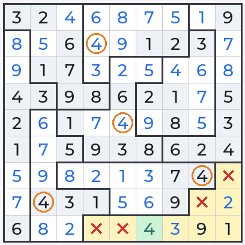

<!-- Written by tools/walkthrough.py jigsaw: edit the script, not this page. -->
# Jigsaw, step 39: the 4 in region 9

**Step 39 of 43** · [← Step 38](step-38.md) · [All steps](../jigsaw.md#the-whole-puzzle-step-by-step) · [Step 40 →](step-40.md)

Region 9 needs a 4. r7c9: row 7 has one (r7c8). r8c8: row 8 has one (r8c2). r9c4: column 4 has one (r2c4). r9c5: column 5 has one (r5c5). Only **r9c6** is left: **r9c6 = 4**.

**Step 39 of 43** · [← Step 38](step-38.md) · [All steps](../jigsaw.md#the-whole-puzzle-step-by-step) · [Step 40 →](step-40.md)
