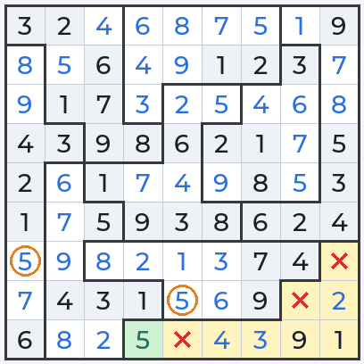

<!-- Written by tools/walkthrough.py jigsaw: edit the script, not this page. -->
# Jigsaw, step 40: the 5 in region 9

**Step 40 of 43** · [← Step 39](step-39.md) · [All steps](../jigsaw.md#the-whole-puzzle-step-by-step) · [Step 41 →](step-41.md)

Region 9 needs a 5. r7c9: row 7 has one (r7c1). r8c8: row 8 has one (r8c5). r9c5: column 5 has one (r8c5). Only **r9c4** is left: **r9c4 = 5**.

**Step 40 of 43** · [← Step 39](step-39.md) · [All steps](../jigsaw.md#the-whole-puzzle-step-by-step) · [Step 41 →](step-41.md)
