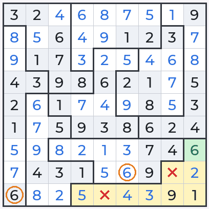

<!-- Written by tools/walkthrough.py jigsaw: edit the script, not this page. -->
# Jigsaw, step 41: the 6 in region 9

**Step 41 of 43** · [← Step 40](step-40.md) · [All steps](../jigsaw.md#the-whole-puzzle-step-by-step) · [Step 42 →](step-42.md)

Region 9 needs a 6. r8c8: row 8 has one (r8c6). r9c5: row 9 has one (r9c1). Only **r7c9** is left: **r7c9 = 6**.

**Step 41 of 43** · [← Step 40](step-40.md) · [All steps](../jigsaw.md#the-whole-puzzle-step-by-step) · [Step 42 →](step-42.md)
