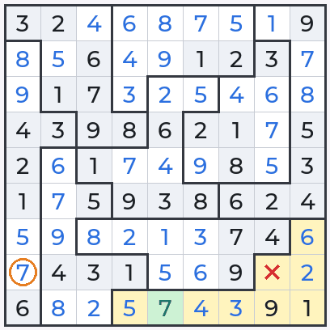

<!-- Written by tools/walkthrough.py jigsaw: edit the script, not this page. -->
# Jigsaw, step 42: the 7 in region 9

**Step 42 of 43** · [← Step 41](step-41.md) · [All steps](../jigsaw.md#the-whole-puzzle-step-by-step) · [Step 43 →](step-43.md)

Region 9 needs a 7. r8c8: row 8 has one (r8c1). Only **r9c5** is left: **r9c5 = 7**.

**Step 42 of 43** · [← Step 41](step-41.md) · [All steps](../jigsaw.md#the-whole-puzzle-step-by-step) · [Step 43 →](step-43.md)
